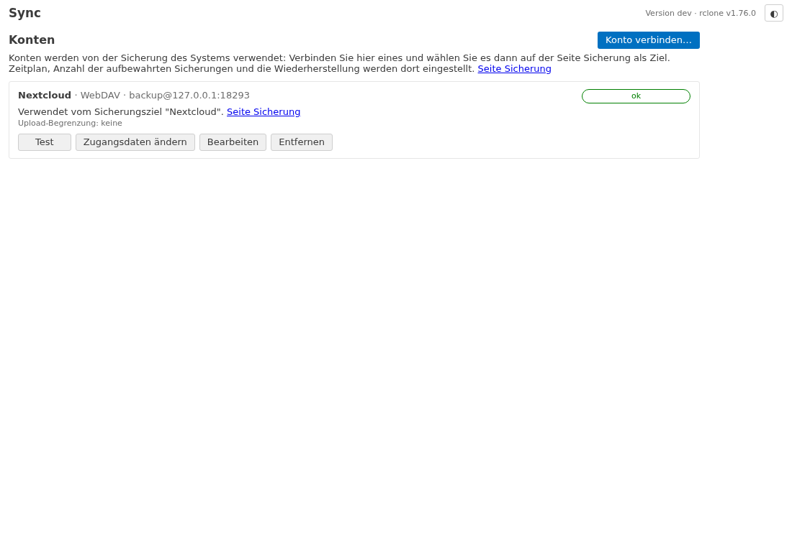
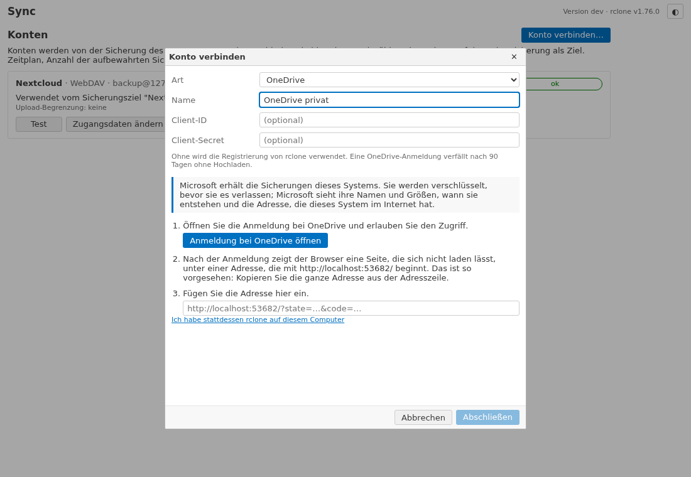

# lite-addon-sync

*[Deutsch](README.md)*

> **Needs openccu-lite 2.0.0-beta.7 or newer** (the first version in which an addon can provide backup targets). An
> older system does not install the addon; the manifest names the minimum (`requires.lite`).

**Cloud storage as a backup target** for an [openccu-lite](https://github.com/openccu-lite/openccu-lite) system:
connect an account at OneDrive, Google Drive or Dropbox, an S3 bucket or a WebDAV server (Nextcloud), and choose it as
a target on the system's **Backup** page - beside the USB stick, the network share and the SSH server, with the same
schedule, the same retention, *Test*, *Back up now*, *Backups here* and *Restore this*. The transfer is
[rclone](https://rclone.org)'s, which comes with the addon and is never part of the system image.



## What it does

- **Connects accounts** (the addon's page): OneDrive, Google Drive and Dropbox with a login at the provider, S3 and
  WebDAV with keys. Test, log in again or change the credentials (the account and every target on it stay), an upload
  limit, remove. An account a backup target uses is not removed unseen: the question names the target.
- **Is a backup target** (the system's Backup page): **Cloud storage** appears under *Add target*. A target names an
  account and a folder there; everything else - when backups are made, how many are kept, the restore - is set there
  as for every other target. The addon has no schedule and no list of its own for it.
- **Encrypted only.** The system gives an addon encrypted backups alone (`.sbk.age`); a cloud target cannot even be
  made without a recovery key. Neither the addon nor the provider ever holds a key of the system. The provider sees
  the files' names and sizes, the time, and the system's address on the internet.
- **Nothing before the first account.** Installed, the addon contacts nothing. After that only the account's provider:
  at the login, at a test and when the system hands over a backup. No telemetry, no update check of its own.

## Logging in at OneDrive, Google Drive, Dropbox

A provider's login ends at the address `http://localhost:53682/` - on the computer rclone runs on, and that is the
system, not your PC. Hence two ways, both in the dialog:

1. **With this browser** (the default): *Open the login* - log in at the provider and allow the access - the browser
   then shows a **page that cannot be loaded**; that is expected. Copy its whole address from the address bar and
   paste it into the dialog. Nothing needs to be installed on your PC.
2. **With rclone on another computer:** the dialog shows the command `rclone authorize "…"`; run it where a browser
   is, and paste what it prints.



What the providers ask for:

| Provider | Client ID | Notes |
| --- | --- | --- |
| **OneDrive** | optional (else rclone's registration) | The login lapses after 90 days without an upload; the nightly backup keeps it alive. Two weeks before, the system's Status page says so. After that: *Log in again* |
| **Google Drive** | **your own is needed**: the one rclone shares is being retired. Create an OAuth client of the type *Desktop app* in the Google Cloud console ([step by step at rclone](https://rclone.org/drive/#making-your-own-client-id)) and **publish** the app - in the *Testing* status the login lapses after 7 days | The addon sees only what it made itself (`drive.file`). The way without a browser: a **service account** (a JSON key) and a folder of your Drive that you share with its address |
| **Dropbox** | optional (else rclone's app, with shared limits) | An app of your own of the type *App folder* confines the system to one folder of your Dropbox |

**S3** (AWS, MinIO, Wasabi, Cloudflare R2, Hetzner, …): endpoint, bucket (it must exist), access key and secret key -
best a key that may read and write this bucket and nothing else. **WebDAV / Nextcloud:** the address
(`https://…/remote.php/dav/files/<name>`), the user and an **app password**.

## Restoring from the cloud

- **The system runs:** Backup page → the cloud target → *Backups here* → *Restore this*. The file is fetched through
  the addon and checked; nothing is applied before you confirm.
- **A new system:** either download the newest `.sbk.age` from the cloud in a browser and upload it on the Backup page
  (with the recovery key) - that needs no addon. Or install the addon, connect the account, add a target with the same
  folder and restore from there.
- After a restore the accounts and targets are back (they are in the backup); the addon's programs are not (rclone
  alone is 80 MB and is left out of the backup). The Addons page offers the reinstall; until then the target says
  *addon missing*.

## Security

- The addon runs **as its own user** (`addon-sync`), with no privilege and no open port. It reads nothing of the
  system: the system hands it each backup as a stream over a socket of its own that only the system's service reaches
  (`/run/occulite/backup-targets/sync/`).
- Its programs (`lite-sync`, `rclone`) are root's; the addon's user cannot replace them.
- **The accounts' logins and keys** are in `/usr/local/etc/config/addons/sync/rclone.conf` (`0600`) - and so in every
  backup of the system. Passwords there are obscured, not encrypted (that is how rclone stores them). Encrypted
  backups protect them; the addon's API never returns a secret.
- rclone is the release binary from [rclone.org](https://rclone.org/downloads/), checked against a pinned SHA-256 at
  build time (`scripts/rclone.pin`). A workflow follows rclone's releases.

## Not in it yet

Copy jobs for folders of the system (with rsync, a simple schedule, and the Services page for everything beyond it)
are the next step.

## Developing

```sh
scripts/fetch-rclone.sh x86_64                      # the pinned rclone, checked
go test ./...                                       # with rclone against a local WebDAV server, no cloud account
(cd ui && npm ci && npm run check && npm test && npm run build && npx playwright test)
VERSION=0.1.0 scripts/build.sh                      # dist/sync-<arch>-<version>.tar.gz
```

The page's API: [docs/api.md](docs/api.md). The contract between the system and the addon (six calls over the socket)
is `docs/backup-provider.md` in [occulited](https://github.com/openccu-lite/occulited);
`occulited -backup provider-check sync <account id> <folder>` holds a running provider against it.

## Licence

MIT. rclone is MIT-licensed (Nick Craig-Wood and contributors); the licence texts are in the package under
`licences/`.
