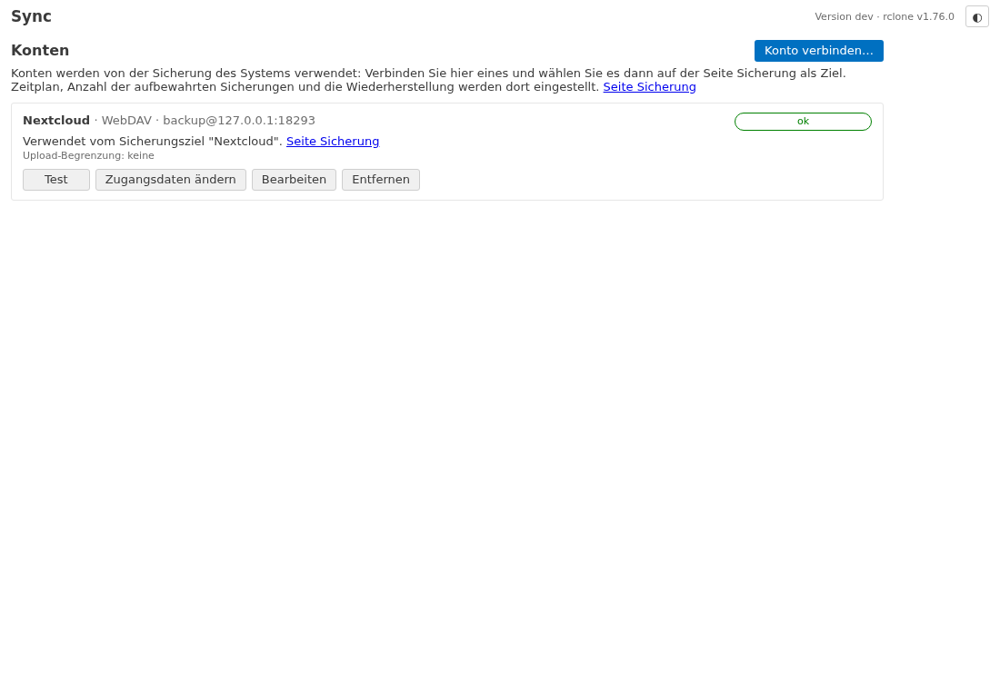
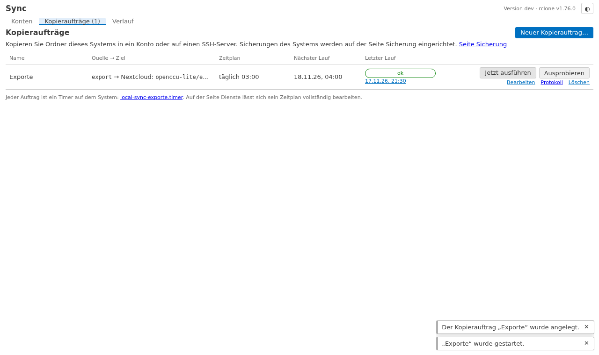
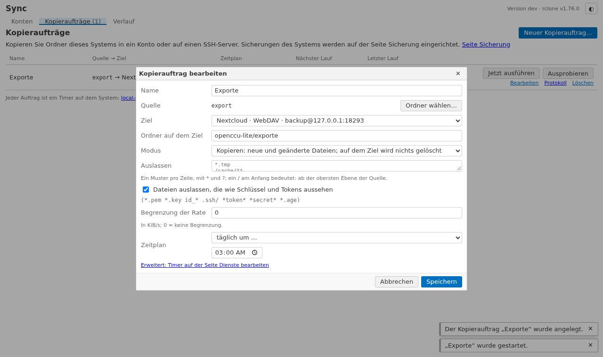
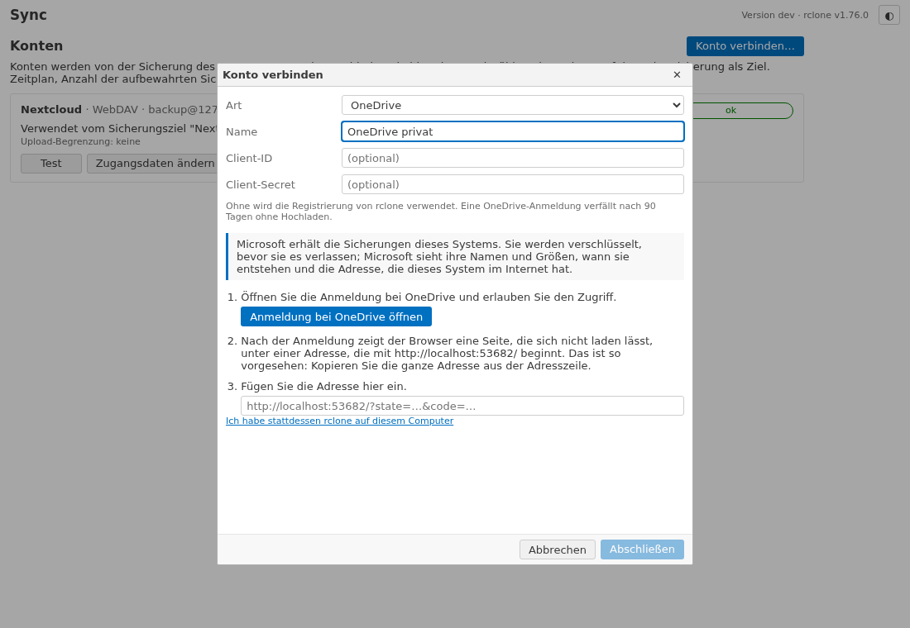

# lite-addon-sync

*[English](README.en.md)*

> **Benötigt openccu-lite 2.0.0-beta.7 oder neuer** (die erste Version, in der ein Addon Sicherungsziele bereitstellen
> und eigene Timer halten kann). Auf einem älteren System lässt sich das Addon nicht installieren; das Manifest nennt
> die Mindestversion (`requires.lite`).

**Cloud-Speicher als Sicherungsziel** für ein [openccu-lite](https://github.com/openccu-lite/openccu-lite)-System:
Verbinden Sie ein Konto bei OneDrive, Google Drive oder Dropbox, einen S3-Bucket oder einen WebDAV-Server (Nextcloud),
und wählen Sie es auf der Seite **Sicherung** des Systems als Ziel – neben USB-Stick, Netzwerkfreigabe und SSH-Server,
mit demselben Zeitplan, derselben Aufbewahrung, *Test*, *Jetzt sichern*, *Sicherungen dort* und *Diese
wiederherstellen*. Die Übertragung macht [rclone](https://rclone.org), das mit dem Addon kommt und nie Teil des
System-Images ist.



## Was es tut

- **Konten verbinden** (Seite des Addons): OneDrive, Google Drive und Dropbox mit einer Anmeldung beim Anbieter, S3 und
  WebDAV mit Schlüsseln. Testen, erneut anmelden oder die Zugangsdaten ändern (das Konto und jedes Ziel darauf
  bleiben), eine Upload-Begrenzung, entfernen. Ein Konto, das ein Sicherungsziel verwendet, wird nicht unbemerkt
  entfernt: Die Frage nennt das Ziel.
- **Sicherungsziel sein** (Seite Sicherung des Systems): Unter *Ziel hinzufügen* erscheint **Cloud-Speicher**. Ein Ziel
  nennt ein Konto und einen Ordner dort; alles andere – wann gesichert wird, wie viele Sicherungen bleiben, das
  Wiederherstellen – stellen Sie dort ein wie bei jedem anderen Ziel. Das Addon hat dafür keinen Zeitplan und keine
  eigene Liste.
- **Nur verschlüsselt.** Das System gibt einem Addon ausschließlich verschlüsselte Sicherungen (`.sbk.age`); ein
  Cloud-Ziel lässt sich ohne Wiederherstellungsschlüssel gar nicht anlegen. Weder das Addon noch der Anbieter halten je
  einen Schlüssel des Systems. Der Anbieter sieht Namen und Größe der Dateien, den Zeitpunkt und die Internetadresse
  des Systems.
- **Nichts vor dem ersten Konto.** Installiert kontaktiert das Addon nichts. Danach nur den Anbieter des Kontos: bei der
  Anmeldung, beim Test und wenn das System eine Sicherung übergibt. Keine Telemetrie, keine eigene Update-Prüfung.

## Kopieraufträge

Neben der Sicherung kopiert das Addon **einen Ordner des Systems** in ein Konto oder auf einen SSH-Server – in eine
Richtung, nach Zeitplan. Das ist keine Sicherung des Systems (die läuft über die Seite Sicherung), sondern für Daten,
die Sie zusätzlich woanders haben möchten: die Datenbank eines Addons, Exporte, Bilder.

- **Quelle:** ein Ordner unter `/usr/local`, gewählt in einer Ordnerauswahl. **Nie kopiert** und nie angeboten: die
  Einstellungen des Systems und aller Addons (`/usr/local/etc`, mit ihren Schlüsseln und Passwörtern – sie verlassen
  das System in seiner Sicherung, verschlüsselt), Sicherungen des Systems, temporäre Dateien, die Programmdateien der
  Addons.
  Dateien, die wie Schlüssel und Tokens aussehen (`*.pem`, `*.key`, `id_*`, `*token*` …), bleiben standardmäßig aus.
  Die Daten eines anderen Addons lassen sich wählen; der Auftrag liest sie dann mit den Rechten jenes Addons, und der
  Dialog sagt, was das öffnet.
- **Ziel:** ein Konto (mit rclone) oder ein **SSH-Server** (mit rsync). Für einen SSH-Server erzeugt das Addon ein
  Schlüsselpaar und zeigt die Zeile für die `authorized_keys` des Servers (mit `restrict`); eine Anmeldung mit Passwort
  gibt es nicht. Der Hostschlüssel des Servers wird gelesen, angezeigt und erst nach Ihrer Bestätigung vertraut – ein
  Lauf nimmt nie unterwegs einen Hostschlüssel an. rsync und ssh sind die des Systems.
- **Modus:** *Kopieren* (neue und geänderte Dateien; auf dem Ziel wird nichts gelöscht) oder *Spiegeln* (das Ziel wird
  wie die Quelle – höchstens 50 Löschungen pro Lauf, und erst, nachdem Sie den Auftrag ausprobiert und sich angesehen
  haben, was er tun würde). *Ausprobieren* kopiert nichts und listet auf, was ein Lauf täte.
- **Zeitplan:** nur manuell, stündlich, täglich oder wöchentlich. Jeder Auftrag ist ein Timer des Systems
  (`local-sync-<auftrag>`): Die Seite **Dienste** zeigt ihn, startet ihn und bearbeitet seinen Zeitplan vollständig.
  Ein dort bearbeiteter Timer erscheint hier als *benutzerdefiniert* und bleibt unangetastet, bis Sie ihn ersetzen.
- **Versionen:** Auf Wunsch bleibt erhalten, was ein Lauf auf dem Ziel ersetzt oder löscht: Es kommt in den Ordner
  `.versions` im Ordner des Auftrags, ein Ordner pro Lauf, und wird nach der eingestellten Zahl von Tagen wieder
  entfernt (oder nie).
- **Überfällig:** Ein Auftrag mit Zeitplan, dessen letzter erfolgreicher Lauf länger her ist als das Doppelte seines
  Abstands, steht als Hinweis auf der Seite Status des Systems, bis wieder ein Lauf gelingt.
- **Verlauf:** jeder Lauf mit dem, was er kopiert, ersetzt und gelöscht hat, seinen Fehlern und seiner Dateiliste;
  die Läufe stehen auch im Protokoll des Systems unter der Unit des Auftrags.





## Anmelden bei OneDrive, Google Drive, Dropbox

Die Anmeldung eines Anbieters endet auf der Adresse `http://localhost:53682/` – auf dem Computer, auf dem rclone läuft,
und das ist das System, nicht Ihr PC. Deshalb zwei Wege, beide im Dialog:

1. **Mit diesem Browser** (Standard): *Anmeldung öffnen* – beim Anbieter anmelden und den Zugriff erlauben – der
   Browser zeigt danach eine **Seite, die sich nicht laden lässt**; das ist so vorgesehen. Kopieren Sie deren ganze
   Adresse aus der Adresszeile und fügen Sie sie im Dialog ein. Auf Ihrem PC muss nichts installiert sein.
2. **Mit rclone auf einem anderen Computer:** Der Dialog zeigt den Befehl `rclone authorize "…"`; führen Sie ihn dort
   aus, wo ein Browser ist, und fügen Sie ein, was er ausgibt.



Was die Anbieter verlangen:

| Anbieter | Client-ID | Hinweise |
| --- | --- | --- |
| **OneDrive** | optional (sonst die Registrierung von rclone) | Die Anmeldung verfällt nach 90 Tagen ohne Hochladen; mit der nächtlichen Sicherung bleibt sie gültig. Zwei Wochen vorher meldet es die Statusseite des Systems. Danach: *Erneut anmelden* |
| **Google Drive** | **eine eigene ist nötig**: Die von rclone geteilte wird abgeschaltet. In der Google-Cloud-Konsole einen OAuth-Client vom Typ *Desktop-App* anlegen ([Schritt für Schritt bei rclone](https://rclone.org/drive/#making-your-own-client-id)) und die App **veröffentlichen** – im Status *Testing* verfällt die Anmeldung nach 7 Tagen | Das Addon sieht nur, was es selbst angelegt hat (`drive.file`). Alternative ohne Browser: ein **Dienstkonto** (JSON-Schlüssel) und ein Ordner Ihres Drive, den Sie für dessen Adresse freigeben |
| **Dropbox** | optional (sonst die App von rclone, mit geteilten Limits) | Eine eigene App vom Typ *App-Ordner* beschränkt das System auf einen Ordner Ihrer Dropbox |

**S3** (AWS, MinIO, Wasabi, Cloudflare R2, Hetzner, …): Endpunkt, Bucket (muss existieren), Zugriffs- und geheimer
Schlüssel – am besten ein Schlüssel, der nur diesen Bucket lesen und schreiben darf. **WebDAV / Nextcloud:** die
Adresse (`https://…/remote.php/dav/files/<name>`), Benutzer und ein **App-Passwort**.

## Wiederherstellen aus der Cloud

- **Das System läuft:** Seite Sicherung → das Cloud-Ziel → *Sicherungen dort* → *Diese wiederherstellen*. Die Datei
  wird über das Addon geholt und geprüft; angewendet wird erst nach Ihrer Bestätigung.
- **Ein neues System:** entweder die neueste `.sbk.age` im Browser aus der Cloud laden und auf der Seite Sicherung
  hochladen (mit dem Wiederherstellungsschlüssel) – dafür braucht es das Addon nicht. Oder das Addon installieren, das
  Konto verbinden, ein Ziel mit demselben Ordner anlegen und von dort wiederherstellen.
- Nach einer Wiederherstellung sind die Konten und Ziele wieder da (sie liegen in der Sicherung); die Programme des
  Addons nicht (rclone allein hat 80 MB und ist von der Sicherung ausgenommen). Die Seite Zusatzsoftware bietet die
  Neuinstallation an; bis dahin zeigt das Ziel *Addon fehlt*.

## Sicherheit

- Das Addon läuft **als eigener Benutzer** (`addon-sync`), ohne Zusatzrecht, ohne offenen Port. Es liest nichts vom
  System: Das System reicht ihm jede Sicherung als Datenstrom über einen eigenen Socket, den nur der Systemdienst
  erreicht (`/run/occulite/backup-targets/sync/`).
- Die Programme (`lite-sync`, `rclone`) gehören root; der Benutzer des Addons kann sie nicht austauschen.
- **Die Anmeldungen und Schlüssel der Konten** liegen in `/usr/local/etc/config/addons/sync/rclone.conf` (`0600`) – und
  damit in jeder Sicherung des Systems. Passwörter sind dort nur verschleiert, nicht verschlüsselt (so speichert rclone
  sie). Verschlüsselte Sicherungen schützen sie; die API des Addons gibt nie ein Geheimnis zurück.
- rclone ist das Release-Binary von [rclone.org](https://rclone.org/downloads/), beim Bau gegen eine festgeschriebene
  SHA-256 geprüft (`scripts/rclone.pin`). Ein Workflow folgt den rclone-Releases und veröffentlicht für jedes eine neue
  Version des Addons.
- **Kopieraufträge** laufen nicht im Dienst des Addons, sondern jeder in einer eigenen Unit des Systems, als Benutzer
  des Addons und ohne Zusatzrecht. Das Addon hält dafür das Recht `timers:addon`: Es übergibt dem System den Zeitplan;
  was die Unit ausführt (`lite-sync run <auftrag>` aus dem root-eigenen Programmverzeichnis), schreibt das System
  selbst. Das Addon hat nicht `system:write`. Es gibt kein Feld für freie Optionen von rsync oder rclone.
- **Die Schlüssel der SSH-Server** liegen in `/usr/local/etc/config/addons/sync/ssh/` (`0600`), ebenfalls in jeder
  Sicherung des Systems.

## Noch nicht enthalten

Die Kopien auf dem Ziel verschlüsseln (rclone crypt).

## Entwickeln

```sh
scripts/fetch-rclone.sh x86_64                      # das festgeschriebene rclone, geprüft
go test ./...                                       # mit rclone gegen einen lokalen WebDAV-Server, ohne Cloud-Konto
(cd ui && npm ci && npm run check && npm test && npm run build && npx playwright test)
VERSION=0.1.0 scripts/build.sh                      # dist/sync-<arch>-<version>.tar.gz
```

Die API der Seite: [docs/api.md](docs/api.md). Der Vertrag zwischen System und Addon (sechs Aufrufe über den Socket)
ist `docs/backup-provider.md` in [occulited](https://github.com/openccu-lite/occulited);
`occulited -backup provider-check sync <Konto-ID> <Ordner>` prüft einen laufenden Anbieter dagegen.

## Lizenz

MIT. rclone ist MIT-lizenziert (Nick Craig-Wood und Mitwirkende); die Lizenztexte liegen im Paket unter `licences/`.
